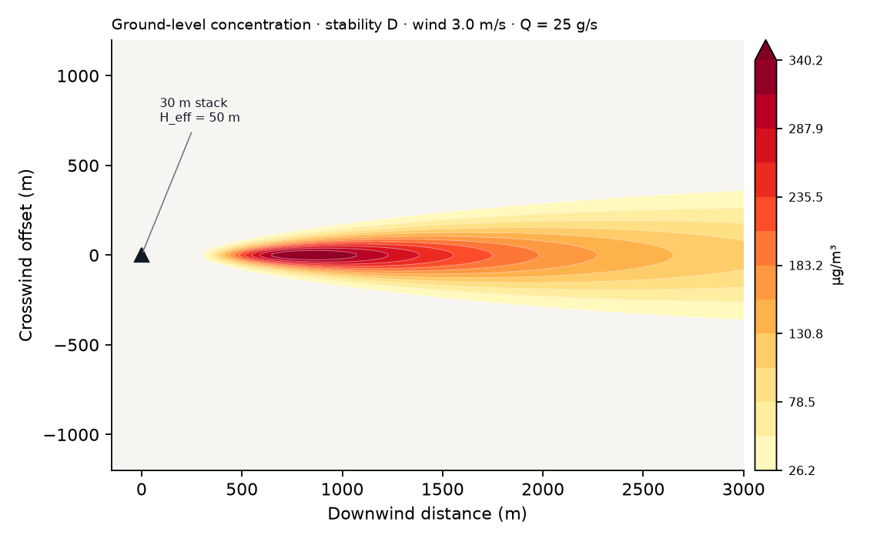

# GHG Inventory & Dispersion Engine

A GHG inventory tool for an exporting manufacturer that has to answer **two
regulators with one stack**: the carbon it reports (EU CBAM, ISO 14064-1) and the
air quality it causes downwind (local permitting). Most tools do one or the
other; the emissions leaving a stack and the concentration arriving at a
neighbour's fence are the same physical event.

```bash
git clone <this-repo> && cd ghg-inventory-engine
docker build -t ghg-engine .
docker run --rm --user "$(id -u):$(id -g)" -v "$PWD/out:/app/out" ghg-engine
```

Two commands and a clone. The first run prints the inventory to stdout and
writes four files into `out/`: the Markdown report, the same report as PDF, and
the two chart PNGs the report embeds. No spreadsheet, no API key, no network.

`--user` matters: the container runs unprivileged and a bind-mounted directory
does not inherit the image's permissions, so without it the report is written as
uid 10001 and your own user cannot overwrite it on the next run.

---

## What the output looks like

Committed in [`out/`](out/) so you can read the deliverable without building it:

- [`emissions_report.md`](out/emissions_report.md) / [`emissions_report.pdf`](out/emissions_report.pdf) — the full report
- [`plume_footprint.png`](out/plume_footprint.png) — the downwind concentration map
- [`scope_breakdown.png`](out/scope_breakdown.png) — scope totals
- [`monthly_trend.png`](out/monthly_trend.png) — monthly series



The headline: **3,737 tCO₂e** for the year — 36.4% Scope 1, 57.2% Scope 2, 6.4%
Scope 3 — and a peak ground-level concentration of **340 µg/m³ at 811 m**
downwind, from a 25 g/s release at a 30 m stack in neutral air.

## What it does

| Stage | What happens | Why it is built this way |
|---|---|---|
| **Ingest** | Monthly activity CSV: kWh, litres, tonnes, tonne-km | Every row validated at the boundary; a unit typo fails loudly instead of landing in a total |
| **Factor join** | Activity × cited emission factor → one line per gas | Factors live in a CSV with citation + year; a factor with no citation cannot load |
| **Scope totals** | Scope 1 (combustion), Scope 2 (grid), Scope 3 (freight) | Same arithmetic as the ledger, so the headline is checkable by hand |
| **Dispersion** | Gaussian plume, Pasquill–Gifford stability, Briggs σ | Ground reflection + mixing-lid reflection; the standard screening model |
| **Footprint** | Contoured downwind concentration zone (µg/m³) | A single receptor answers "are we over the limit"; the map answers "who is" |
| **Report** | Markdown + PDF, charts, provenance table | One authored source, rendered twice — the two can't disagree |

## The numbers, and where they come from

Every emission factor is in [`data/factors/emission_factors.csv`](data/factors/emission_factors.csv)
with its citation and publication year. The register is data, not code, so an
auditor reads it next to the report. Current contents:

| Source | Factor basis | Scope |
|---|---|---|
| `grid_electricity` | Vietnam grid EF 0.6187 tCO₂/MWh (data year 2024, DCC/MAE) | 2 |
| `diesel_furnace` | IPCC 2006 Table 1.4 CO₂ + Table 2.3 CH₄/N₂O, × NCV, × 0.84 kg/L | 1 |
| `coal_boiler` | IPCC 2006 Table 1.4 CO₂ + Table 2.3 CH₄/N₂O, × NCV (other bituminous) | 1 |
| `inbound_freight_road` | GLEC / UK DESNZ 2024, road HGV tonne-km | 3 |
| `inbound_freight_sea` | GLEC / UK DESNZ 2024, container ship tonne-km | 3 |

### Three factor choices that are easy to get wrong

These are the ones a reviewer checks, and where this tool deliberately differs
from a naive spreadsheet:

1. **Table 2.3, not Table 2.2.** IPCC's Table 2.2 gives CH₄/N₂O for *energy
   industries* (power and heat generation). A factory's furnace and boiler belong
   to Table 2.3, *manufacturing and construction*, where diesel CH₄ is 10 kg/TJ
   rather than 3 and coal CH₄ is 10 kg/TJ rather than 1. Using the power-sector
   table on an industrial stack understates methane by 3–10×.
2. **Non-fossil methane for combustion.** GHG Protocol's GWP guidance assigns
   CH₄ **non-fossil (27.0)** to stationary and mobile combustion, and reserves
   fossil CH₄ (29.8) for fugitive fossil sources. The register therefore carries
   `CH4_non_fossil`; the two are not interchangeable and the loader rejects a
   generic `CH4`.
3. **Latest official grid factor.** Vietnam publishes one national value a year,
   with no regional or hourly split: 0.9130 (2018) → 0.6766 (2022) → 0.6592
   (2023) → **0.6187 (2024, latest)**. The register uses 2024. Note this is a
   *location-based* factor; a market-based figure needs contractual instruments
   and is a separate methodology.

The IPCC tables are unchanged by the 2019 Refinement (Vol. 2 Ch. 1 and Ch. 2 are
both marked "no refinement" for these values).

> **Factors are only as good as their edition.** A factor update changes the
> total without changing any activity data. The register carries
> `publication_year` per row precisely so a year-on-year comparison can be
> attributed to the factor change rather than to a real reduction. On its own,
> switching this facility's Scope 2 from the 2022 to the 2024 grid factor would
> move the total by about 8.6% with no physical change at all.

Global warming potentials are **IPCC AR6 WG1, 100-year**: CO₂ 1.0, CH₄ fossil
29.8, CH₄ non-fossil 27.0, N₂O 273.0.

## Honest limits

This is a calculation engine, not an assurance opinion and not a compliance
determination.

- **Dispersion is a screening model.** Gaussian plume assumes steady wind, flat
  terrain, no chemistry, no deposition, one point source. Regulators screen
  permits with it; a site-specific AERMOD run is what an EIA actually requires.
- **Scope 2 is location-based.** A market-based figure needs contractual
  instruments (RECs, PPAs) and is a separate methodology, not a second column.
- **Freight is tank-to-wheel only.** Well-to-wheel would roughly double it.
- **One facility, operational control.** A group inventory needs a consolidation
  boundary and a statement of which one.
- **The activity data is simulated.** It is shaped like a real plant (seasonal
  electricity load, winter steam demand) so the pipeline is exercised
  realistically, not because the numbers belong to anyone.

## Repository layout

```
src/ghg/
  activity.py    # CSV ingest, unit canonicalisation, fail-closed validation
  factors.py     # factor register loader, AR6 GWP table, unit maths
  inventory.py   # join + convert + aggregate
  dispersion.py  # Gaussian plume, Briggs coefficients, plume rise
  plume_map.py   # vectorised concentration field + contour map
  chart.py       # scope breakdown + monthly trend PNGs
  report.py      # Markdown generation
  pdf.py         # Markdown -> PDF renderer
  cli.py         # `ghg inventory | dispersion | factors`
data/
  activity/      # the monthly activity extract
  factors/       # the cited factor register
  stack.json     # stack + meteorology for the dispersion section
tests/           # pytest: validation, arithmetic, physics, report, PDF, pipeline
```

## How the dispersion model was verified

The chemistry and the plumbing are easy to get right; the physics is where a
plausible number hides a wrong one. So the constants were checked against
published sources rather than written from memory, and each check is a test:

| Claim | How it is pinned |
|---|---|
| Briggs rural σ_y, σ_z coefficients | `test_briggs_sigma_is_a_factor_of_x_in_neutral_air` — note σ_z uses b=0.0015, not σ_y's 0.0001 |
| Briggs urban E/F coefficient | `test_urban_coefficient_tables_differ_from_rural_per_class` — catches the 0.00015 → 0.0015 slip |
| Rural vs urban wind-profile exponents | `test_wind_profile_increases_with_height` — p=0.15 rural / 0.25 urban for class D |
| Holland plume rise | `test_holland_plume_rise_by_hand` — arithmetic in the docstring, 20.03 m |
| Briggs stack-tip downwash *lowers* the stack | `test_downwash_correction_lowers_the_stack_for_a_lazy_plume` — h' = h + 2[(vs/u)−1.5]d |
| Ground-level Gaussian with reflection ×2 | `test_centreline_concentration_by_hand` — full worked sum, 222.9 µg/m³ at 500 m |
| Lid reflection series | `test_mixing_lid_stops_the_far_field_from_decaying_away` |
| Well-mixed limit when σ_z > 1.6·L | `test_well_mixed_limit_is_used_when_sigma_exceeds_the_lid` |
| Map agrees with scalar model | `test_map_summary_matches_the_scalar_model` — the numpy and scalar paths are separate implementations |
| Peak is downwind, not at the stack | `test_peak_is_a_local_maximum` |

### Five bugs found during development, all of which produced plausible output

1. **Stack-tip downwash applied backwards.** I had raised a slow exit velocity to
   1.5u; Briggs actually *lowers the stack height* by `2[(vs/u)−1.5]d`. The
   effect is non-conservative — it under-predicts ground-level concentration for
   exactly the low-velocity stacks a permit reviewer asks about.
2. **Urban wind exponents on rural sites.** Class F at a 30 m stack differs by
   24% between the two sets, and concentration is inversely proportional to wind
   speed, so every stable-air rural result was biased.
3. **Urban σ_z coefficient for E/F was 10× too large** — invisible at 500 m,
   wrong at 2 km where a fence-line receptor sits.
4. **`mass_emitted_kg` ignored the factor's mass-unit multiplier** while `tCO2e`
   applied it, so the two ledger columns disagreed by 1000× for gram-based
   factors.
5. **The provenance table declared 7 columns and emitted 6**, so the PDF renderer
   silently dropped every row. A column-count test now guards it.

Two of these (1 and 2) were caught by an independent review of the physics after
the tests were green — which is the argument for having the numbers checked
against a published source rather than only against themselves.

## Running it

### Docker (the intended path)

```bash
docker build -t ghg-engine .
docker run --rm --user "$(id -u):$(id -g)" -v "$PWD/out:/app/out" ghg-engine
```

### Tests, in the same image

```bash
docker run --rm ghg-engine pytest -q
```

### Without Docker

```bash
python -m venv .venv && . .venv/bin/activate
pip install -e ".[dev]"
ghg inventory --out out
pytest -q
```

### Ad-hoc dispersion

```bash
ghg dispersion --height 30 --emission 25 --wind 3 --stability D \
               --distance 100 300 500 1000 2000
```

Prints ground-level concentration (µg/m³) on the plume centreline at each
distance. `--mixing-height` enables lid reflection.

## Using it on your own plant

1. Replace `data/activity/activity_2025.csv`. Required columns: `period` (ISO
   month), `site`, `activity_source`, `quantity`, `unit`.
2. Point each `activity_source` at a factor row in
   `data/factors/emission_factors.csv`. An unregistered source is an error, by
   design — there is no fallback factor.
3. Check the unit: `activity_unit` must equal the factor's
   `factor_unit_denominator`. There is no implicit kWh→MWh conversion, because
   that is a 1000× error a plausible total hides.
4. Set the stack and meteorology in `data/stack.json`.
5. `ghg inventory`.

## Why the tests are shaped this way

Each test is a specific way the spreadsheet approach fails:

- `test_hand_calculated_diesel_line` — the arithmetic is worked in the docstring
  and asserted, so the tCO₂e column means what the report claims.
- `test_unit_mismatch_fails_rather_than_reinterpreting` — the 1000× error.
- `test_non_monthly_periods_are_rejected` — a quarter labelled `2025-Q1` cannot
  be summed into a monthly series without an allocation someone approved.
- `test_total_appears_in_headline_and_matches_ledger_sum` — re-derives the
  headline from the printed ledger, the way a reviewer checks it.
- `test_mass_unit_gram_is_applied_once` — pins the mass-unit multiplier, which a
  previous version applied in one column and not the other.

## Licence

MIT.
