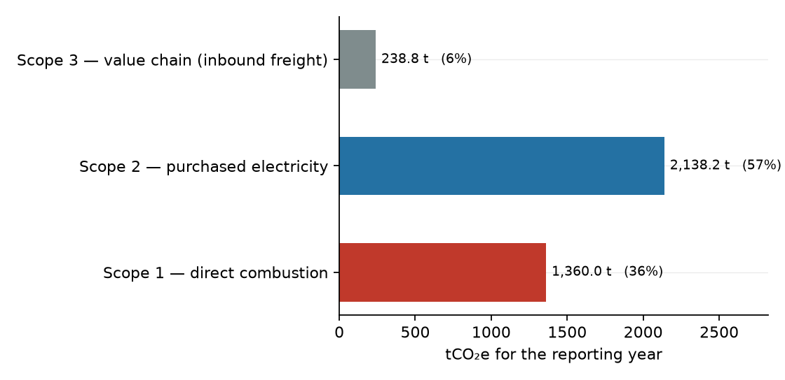
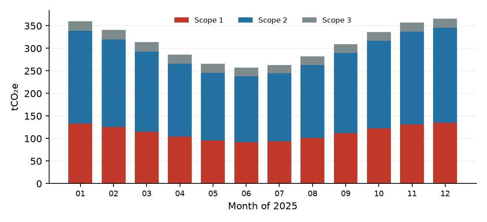
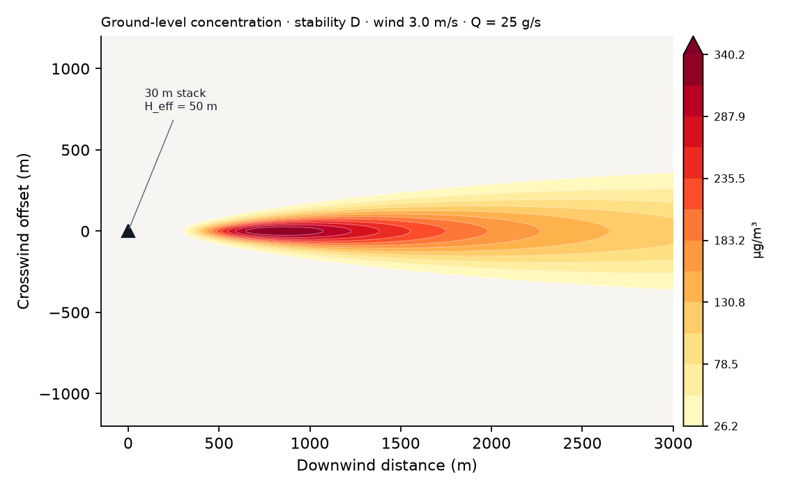

# GHG Emissions Inventory — VSIP-II plant

**Reporting period:** 2025-01 to 2025-12  
**Total emissions:** 3,737.05 tCO₂e  
**GWP basis:** IPCC AR6 WG1, 100-year (Table 7.15)  
**Generated:** 2025-12-01 00:00 UTC by `ghg-inventory-engine`

This report is generated from an activity-data extract joined to a cited emission-factor register. It is a calculation, not an assurance opinion: the boundary, the factor edition and the activity data are the operator's to defend.

## 1. Headline result

| Scope | tCO₂e | Share |
|---|---:|---:|
| Scope 1 — direct emissions | 1,360.01 | 36.4% |
| Scope 2 — purchased energy | 2,138.23 | 57.2% |
| Scope 3 — value chain | 238.81 | 6.4% |
| **Total** | **3,737.05** | 100.0% |

## 2. Where the tonnes come from

| Activity source | tCO₂e | Share of total |
|---|---:|---:|
| `grid_electricity` | 2,138.23 | 57.2% |
| `coal_boiler` | 1,120.94 | 30.0% |
| `diesel_furnace` | 239.06 | 6.4% |
| `inbound_freight_road` | 120.96 | 3.2% |
| `inbound_freight_sea` | 117.85 | 3.2% |

`grid_electricity` dominates at 57.2% of the total. Ranking by source rather than by scope is what turns a number into a reduction plan: scope tells you how you must report it, source tells you what to change.

## 3. Monthly series

| Month | Scope 1 | Scope 2 | Scope 3 | Total |
|---|---:|---:|---:|---:|
| 2025-01 | 132.76 | 205.96 | 20.95 | 359.67 |
| 2025-02 | 125.65 | 194.22 | 21.02 | 340.90 |
| 2025-03 | 115.06 | 178.19 | 20.80 | 314.04 |
| 2025-04 | 104.01 | 162.15 | 20.33 | 286.48 |
| 2025-05 | 95.63 | 150.41 | 19.74 | 265.79 |
| 2025-06 | 91.69 | 146.11 | 19.20 | 257.00 |
| 2025-07 | 93.91 | 150.41 | 18.85 | 263.17 |
| 2025-08 | 101.02 | 162.15 | 18.78 | 281.94 |
| 2025-09 | 111.61 | 178.19 | 19.01 | 308.80 |
| 2025-10 | 122.66 | 194.22 | 19.48 | 336.36 |
| 2025-11 | 131.03 | 205.96 | 20.06 | 357.05 |
| 2025-12 | 134.98 | 210.26 | 20.60 | 365.84 |

## 4. Auditable ledger

One row per gas per source per month. `mass_emitted_kg × GWP100 / 1000` reproduces every `tCO₂e` value here by hand.

| Month | Source | Scope | Gas | Quantity | Factor (kg/unit) | Mass kg | GWP100 | tCO₂e |
|---|---|---:|---|---:|---:|---:|---:|---:|
| 2025-01 | `grid_electricity` | 2 | CO2e | 3.329e+05 kWh | 0.6187 | 205,962.14 | 1.0 | 205.9621 |
| 2025-01 | `diesel_furnace` | 1 | CO2 | 8,041 L | 2.6765 | 21,521.47 | 1.0 | 21.5215 |
| 2025-01 | `diesel_furnace` | 1 | CH4_non_fossil | 8,041 L | 0.000361 | 2.90 | 27.0 | 0.0784 |
| 2025-01 | `diesel_furnace` | 1 | N2O | 8,041 L | 2.17e-05 | 0.17 | 273.0 | 0.0476 |
| 2025-01 | `coal_boiler` | 1 | CO2 | 45.2 t | 2,440.68 | 110,318.74 | 1.0 | 110.3187 |
| 2025-01 | `coal_boiler` | 1 | CH4_non_fossil | 45.2 t | 0.258 | 11.66 | 27.0 | 0.3149 |
| 2025-01 | `coal_boiler` | 1 | N2O | 45.2 t | 0.0387 | 1.75 | 273.0 | 0.4775 |
| 2025-01 | `inbound_freight_road` | 3 | CO2e | 1.037e+05 tkm | 0.105 | 10,886.40 | 1.0 | 10.8864 |
| 2025-01 | `inbound_freight_sea` | 3 | CO2e | 6.252e+05 tkm | 0.0161 | 10,066.52 | 1.0 | 10.0665 |
| 2025-02 | `grid_electricity` | 2 | CO2e | 3.139e+05 kWh | 0.6187 | 194,222.30 | 1.0 | 194.2223 |
| 2025-02 | `diesel_furnace` | 1 | CO2 | 8,140 L | 2.6765 | 21,786.71 | 1.0 | 21.7867 |
| 2025-02 | `diesel_furnace` | 1 | CH4_non_fossil | 8,140 L | 0.000361 | 2.94 | 27.0 | 0.0793 |
| 2025-02 | `diesel_furnace` | 1 | N2O | 8,140 L | 2.17e-05 | 0.18 | 273.0 | 0.0482 |
| 2025-02 | `coal_boiler` | 1 | CO2 | 42.2 t | 2,440.68 | 102,996.70 | 1.0 | 102.9967 |
| 2025-02 | `coal_boiler` | 1 | CH4_non_fossil | 42.2 t | 0.258 | 10.89 | 27.0 | 0.2940 |
| 2025-02 | `coal_boiler` | 1 | N2O | 42.2 t | 0.0387 | 1.63 | 273.0 | 0.4458 |
| 2025-02 | `inbound_freight_road` | 3 | CO2e | 1.027e+05 tkm | 0.105 | 10,778.35 | 1.0 | 10.7784 |
| 2025-02 | `inbound_freight_sea` | 3 | CO2e | 6.364e+05 tkm | 0.0161 | 10,246.27 | 1.0 | 10.2463 |
| 2025-03 | `grid_electricity` | 2 | CO2e | 2.88e+05 kWh | 0.6187 | 178,185.60 | 1.0 | 178.1856 |
| 2025-03 | `diesel_furnace` | 1 | CO2 | 8,041 L | 2.6765 | 21,521.47 | 1.0 | 21.5215 |
| 2025-03 | `diesel_furnace` | 1 | CH4_non_fossil | 8,041 L | 0.000361 | 2.90 | 27.0 | 0.0784 |
| 2025-03 | `diesel_furnace` | 1 | N2O | 8,041 L | 2.17e-05 | 0.17 | 273.0 | 0.0476 |
| 2025-03 | `coal_boiler` | 1 | CO2 | 38 t | 2,440.68 | 92,745.84 | 1.0 | 92.7458 |
| 2025-03 | `coal_boiler` | 1 | CH4_non_fossil | 38 t | 0.258 | 9.80 | 27.0 | 0.2647 |
| 2025-03 | `coal_boiler` | 1 | N2O | 38 t | 0.0387 | 1.47 | 273.0 | 0.4015 |
| 2025-03 | `inbound_freight_road` | 3 | CO2e | 9.984e+04 tkm | 0.105 | 10,483.20 | 1.0 | 10.4832 |
| 2025-03 | `inbound_freight_sea` | 3 | CO2e | 6.405e+05 tkm | 0.0161 | 10,312.05 | 1.0 | 10.3120 |
| 2025-04 | `grid_electricity` | 2 | CO2e | 2.621e+05 kWh | 0.6187 | 162,148.90 | 1.0 | 162.1489 |
| 2025-04 | `diesel_furnace` | 1 | CO2 | 7,770 L | 2.6765 | 20,796.40 | 1.0 | 20.7964 |
| 2025-04 | `diesel_furnace` | 1 | CH4_non_fossil | 7,770 L | 0.000361 | 2.80 | 27.0 | 0.0757 |
| 2025-04 | `diesel_furnace` | 1 | N2O | 7,770 L | 2.17e-05 | 0.17 | 273.0 | 0.0460 |
| 2025-04 | `coal_boiler` | 1 | CO2 | 33.8 t | 2,440.68 | 82,494.98 | 1.0 | 82.4950 |
| 2025-04 | `coal_boiler` | 1 | CH4_non_fossil | 33.8 t | 0.258 | 8.72 | 27.0 | 0.2355 |
| 2025-04 | `coal_boiler` | 1 | N2O | 33.8 t | 0.0387 | 1.31 | 273.0 | 0.3571 |
| 2025-04 | `inbound_freight_road` | 3 | CO2e | 9.6e+04 tkm | 0.105 | 10,080.00 | 1.0 | 10.0800 |
| 2025-04 | `inbound_freight_sea` | 3 | CO2e | 6.364e+05 tkm | 0.0161 | 10,246.27 | 1.0 | 10.2463 |
| 2025-05 | `grid_electricity` | 2 | CO2e | 2.431e+05 kWh | 0.6187 | 150,409.06 | 1.0 | 150.4091 |
| 2025-05 | `diesel_furnace` | 1 | CO2 | 7,400 L | 2.6765 | 19,806.10 | 1.0 | 19.8061 |
| 2025-05 | `diesel_furnace` | 1 | CH4_non_fossil | 7,400 L | 0.000361 | 2.67 | 27.0 | 0.0721 |
| 2025-05 | `diesel_furnace` | 1 | N2O | 7,400 L | 2.17e-05 | 0.16 | 273.0 | 0.0438 |
| 2025-05 | `coal_boiler` | 1 | CO2 | 30.8 t | 2,440.68 | 75,172.94 | 1.0 | 75.1729 |
| 2025-05 | `coal_boiler` | 1 | CH4_non_fossil | 30.8 t | 0.258 | 7.95 | 27.0 | 0.2146 |
| 2025-05 | `coal_boiler` | 1 | N2O | 30.8 t | 0.0387 | 1.19 | 273.0 | 0.3254 |
| 2025-05 | `inbound_freight_road` | 3 | CO2e | 9.216e+04 tkm | 0.105 | 9,676.80 | 1.0 | 9.6768 |
| 2025-05 | `inbound_freight_sea` | 3 | CO2e | 6.252e+05 tkm | 0.0161 | 10,066.52 | 1.0 | 10.0665 |
| 2025-06 | `grid_electricity` | 2 | CO2e | 2.362e+05 kWh | 0.6187 | 146,112.19 | 1.0 | 146.1122 |
| 2025-06 | `diesel_furnace` | 1 | CO2 | 7,030 L | 2.6765 | 18,815.79 | 1.0 | 18.8158 |
| 2025-06 | `diesel_furnace` | 1 | CH4_non_fossil | 7,030 L | 0.000361 | 2.54 | 27.0 | 0.0685 |
| 2025-06 | `diesel_furnace` | 1 | N2O | 7,030 L | 2.17e-05 | 0.15 | 273.0 | 0.0416 |
| 2025-06 | `coal_boiler` | 1 | CO2 | 29.6 t | 2,440.68 | 72,244.13 | 1.0 | 72.2441 |
| 2025-06 | `coal_boiler` | 1 | CH4_non_fossil | 29.6 t | 0.258 | 7.64 | 27.0 | 0.2062 |
| 2025-06 | `coal_boiler` | 1 | N2O | 29.6 t | 0.0387 | 1.15 | 273.0 | 0.3127 |
| 2025-06 | `inbound_freight_road` | 3 | CO2e | 8.935e+04 tkm | 0.105 | 9,381.65 | 1.0 | 9.3816 |
| 2025-06 | `inbound_freight_sea` | 3 | CO2e | 6.1e+05 tkm | 0.0161 | 9,821.00 | 1.0 | 9.8210 |
| 2025-07 | `grid_electricity` | 2 | CO2e | 2.431e+05 kWh | 0.6187 | 150,409.06 | 1.0 | 150.4091 |
| 2025-07 | `diesel_furnace` | 1 | CO2 | 6,759 L | 2.6765 | 18,090.73 | 1.0 | 18.0907 |
| 2025-07 | `diesel_furnace` | 1 | CH4_non_fossil | 6,759 L | 0.000361 | 2.44 | 27.0 | 0.0659 |
| 2025-07 | `diesel_furnace` | 1 | N2O | 6,759 L | 2.17e-05 | 0.15 | 273.0 | 0.0400 |
| 2025-07 | `coal_boiler` | 1 | CO2 | 30.8 t | 2,440.68 | 75,172.94 | 1.0 | 75.1729 |
| 2025-07 | `coal_boiler` | 1 | CH4_non_fossil | 30.8 t | 0.258 | 7.95 | 27.0 | 0.2146 |
| 2025-07 | `coal_boiler` | 1 | N2O | 30.8 t | 0.0387 | 1.19 | 273.0 | 0.3254 |
| 2025-07 | `inbound_freight_road` | 3 | CO2e | 8.832e+04 tkm | 0.105 | 9,273.60 | 1.0 | 9.2736 |
| 2025-07 | `inbound_freight_sea` | 3 | CO2e | 5.948e+05 tkm | 0.0161 | 9,575.48 | 1.0 | 9.5755 |
| 2025-08 | `grid_electricity` | 2 | CO2e | 2.621e+05 kWh | 0.6187 | 162,148.90 | 1.0 | 162.1489 |
| 2025-08 | `diesel_furnace` | 1 | CO2 | 6,660 L | 2.6765 | 17,825.49 | 1.0 | 17.8255 |
| 2025-08 | `diesel_furnace` | 1 | CH4_non_fossil | 6,660 L | 0.000361 | 2.40 | 27.0 | 0.0649 |
| 2025-08 | `diesel_furnace` | 1 | N2O | 6,660 L | 2.17e-05 | 0.14 | 273.0 | 0.0395 |
| 2025-08 | `coal_boiler` | 1 | CO2 | 33.8 t | 2,440.68 | 82,494.98 | 1.0 | 82.4950 |
| 2025-08 | `coal_boiler` | 1 | CH4_non_fossil | 33.8 t | 0.258 | 8.72 | 27.0 | 0.2355 |
| 2025-08 | `coal_boiler` | 1 | N2O | 33.8 t | 0.0387 | 1.31 | 273.0 | 0.3571 |
| 2025-08 | `inbound_freight_road` | 3 | CO2e | 8.935e+04 tkm | 0.105 | 9,381.65 | 1.0 | 9.3816 |
| 2025-08 | `inbound_freight_sea` | 3 | CO2e | 5.836e+05 tkm | 0.0161 | 9,395.73 | 1.0 | 9.3957 |
| 2025-09 | `grid_electricity` | 2 | CO2e | 2.88e+05 kWh | 0.6187 | 178,185.60 | 1.0 | 178.1856 |
| 2025-09 | `diesel_furnace` | 1 | CO2 | 6,759 L | 2.6765 | 18,090.73 | 1.0 | 18.0907 |
| 2025-09 | `diesel_furnace` | 1 | CH4_non_fossil | 6,759 L | 0.000361 | 2.44 | 27.0 | 0.0659 |
| 2025-09 | `diesel_furnace` | 1 | N2O | 6,759 L | 2.17e-05 | 0.15 | 273.0 | 0.0400 |
| 2025-09 | `coal_boiler` | 1 | CO2 | 38 t | 2,440.68 | 92,745.84 | 1.0 | 92.7458 |
| 2025-09 | `coal_boiler` | 1 | CH4_non_fossil | 38 t | 0.258 | 9.80 | 27.0 | 0.2647 |
| 2025-09 | `coal_boiler` | 1 | N2O | 38 t | 0.0387 | 1.47 | 273.0 | 0.4015 |
| 2025-09 | `inbound_freight_road` | 3 | CO2e | 9.216e+04 tkm | 0.105 | 9,676.80 | 1.0 | 9.6768 |
| 2025-09 | `inbound_freight_sea` | 3 | CO2e | 5.795e+05 tkm | 0.0161 | 9,329.95 | 1.0 | 9.3300 |
| 2025-10 | `grid_electricity` | 2 | CO2e | 3.139e+05 kWh | 0.6187 | 194,222.30 | 1.0 | 194.2223 |
| 2025-10 | `diesel_furnace` | 1 | CO2 | 7,030 L | 2.6765 | 18,815.79 | 1.0 | 18.8158 |
| 2025-10 | `diesel_furnace` | 1 | CH4_non_fossil | 7,030 L | 0.000361 | 2.54 | 27.0 | 0.0685 |
| 2025-10 | `diesel_furnace` | 1 | N2O | 7,030 L | 2.17e-05 | 0.15 | 273.0 | 0.0416 |
| 2025-10 | `coal_boiler` | 1 | CO2 | 42.2 t | 2,440.68 | 102,996.70 | 1.0 | 102.9967 |
| 2025-10 | `coal_boiler` | 1 | CH4_non_fossil | 42.2 t | 0.258 | 10.89 | 27.0 | 0.2940 |
| 2025-10 | `coal_boiler` | 1 | N2O | 42.2 t | 0.0387 | 1.63 | 273.0 | 0.4458 |
| 2025-10 | `inbound_freight_road` | 3 | CO2e | 9.6e+04 tkm | 0.105 | 10,080.00 | 1.0 | 10.0800 |
| 2025-10 | `inbound_freight_sea` | 3 | CO2e | 5.836e+05 tkm | 0.0161 | 9,395.73 | 1.0 | 9.3957 |
| 2025-11 | `grid_electricity` | 2 | CO2e | 3.329e+05 kWh | 0.6187 | 205,962.14 | 1.0 | 205.9621 |
| 2025-11 | `diesel_furnace` | 1 | CO2 | 7,400 L | 2.6765 | 19,806.10 | 1.0 | 19.8061 |
| 2025-11 | `diesel_furnace` | 1 | CH4_non_fossil | 7,400 L | 0.000361 | 2.67 | 27.0 | 0.0721 |
| 2025-11 | `diesel_furnace` | 1 | N2O | 7,400 L | 2.17e-05 | 0.16 | 273.0 | 0.0438 |
| 2025-11 | `coal_boiler` | 1 | CO2 | 45.2 t | 2,440.68 | 110,318.74 | 1.0 | 110.3187 |
| 2025-11 | `coal_boiler` | 1 | CH4_non_fossil | 45.2 t | 0.258 | 11.66 | 27.0 | 0.3149 |
| 2025-11 | `coal_boiler` | 1 | N2O | 45.2 t | 0.0387 | 1.75 | 273.0 | 0.4775 |
| 2025-11 | `inbound_freight_road` | 3 | CO2e | 9.984e+04 tkm | 0.105 | 10,483.20 | 1.0 | 10.4832 |
| 2025-11 | `inbound_freight_sea` | 3 | CO2e | 5.948e+05 tkm | 0.0161 | 9,575.48 | 1.0 | 9.5755 |
| 2025-12 | `grid_electricity` | 2 | CO2e | 3.398e+05 kWh | 0.6187 | 210,259.01 | 1.0 | 210.2590 |
| 2025-12 | `diesel_furnace` | 1 | CO2 | 7,770 L | 2.6765 | 20,796.40 | 1.0 | 20.7964 |
| 2025-12 | `diesel_furnace` | 1 | CH4_non_fossil | 7,770 L | 0.000361 | 2.80 | 27.0 | 0.0757 |
| 2025-12 | `diesel_furnace` | 1 | N2O | 7,770 L | 2.17e-05 | 0.17 | 273.0 | 0.0460 |
| 2025-12 | `coal_boiler` | 1 | CO2 | 46.4 t | 2,440.68 | 113,247.55 | 1.0 | 113.2476 |
| 2025-12 | `coal_boiler` | 1 | CH4_non_fossil | 46.4 t | 0.258 | 11.97 | 27.0 | 0.3232 |
| 2025-12 | `coal_boiler` | 1 | N2O | 46.4 t | 0.0387 | 1.80 | 273.0 | 0.4902 |
| 2025-12 | `inbound_freight_road` | 3 | CO2e | 1.027e+05 tkm | 0.105 | 10,778.35 | 1.0 | 10.7784 |
| 2025-12 | `inbound_freight_sea` | 3 | CO2e | 6.1e+05 tkm | 0.0161 | 9,821.00 | 1.0 | 9.8210 |

Ledger sum **3,737.05 tCO₂e** reconciles to the headline total (3,737.05 tCO₂e). No value above is rounded twice.

## 5. Downwind dispersion of the stack plume

The inventory answers **how much** leaves the stack. The screening model below answers **where it goes**: a Gaussian plume with Pasquill–Gifford stability classes, Briggs dispersion coefficients, ground reflection and mixing-lid reflection.

| Parameter | Value |
|---|---:|
| Stack height | 30.0 m |
| Stack diameter | 2.00 m |
| Exit velocity | 12.0 m/s |
| Exit / ambient temperature | 400 / 293 K |
| Emission rate | 25.00 g/s |
| Wind speed (10 m) | 3.0 m/s |
| Stability class | D |
| Mixing height | 800 m |

### Concentration by distance

| Metric | Value |
|---|---:|
| Peak centreline concentration | 340.2 µg/m³ |
| Distance of peak | 811 m downwind |
| Centreline at 500 m | 222.9 µg/m³ |
| Centreline at 1 km | 325.9 µg/m³ |

The peak sits downwind of the stack, not at it: a buoyant plume rises to an effective height well above 30 m and only reaches ground level once turbulent mixing has brought it down. That is why a taller stack or a hotter exhaust moves the maximum further away and lowers it.

Peak ground-level concentration **340.2 µg/m³** at **811 m** downwind on the plume centreline, stability D, wind 3.0 m/s. At 500 m the centreline value is 222.9 µg/m³. Screening estimate only — see `ghg/dispersion.py` for model limits.

## 6. Emission factor provenance

| Source | Gas | Scope | Factor | Citation | Year |
|---|---|---:|---:|---|---:|
| `grid_electricity` | CO2e | 2 | 0.6187 kg/kWh | Vietnam grid emission factor, data year 2024: 0.6187 tCO2/MWh = 0.6187 kgCO2/kWh, announced by the Dept. of Climate Change under the Ministry of Agriculture and Environment, Official Letter dated 30 Sep 2026; location-based; latest official value (no 2025 factor published) | 2024 |
| `diesel_furnace` | CO2 | 1 | 2.6765 kg/L | IPCC 2006 Guidelines Vol.2 Ch.1 Table 1.4 (74100 kg CO2/TJ) x Ch.1 Table 1.2 NCV 43.0 TJ/Gg x density 0.84 kg/L (EN 590 mid-range) | 2006 |
| `diesel_furnace` | CH4_non_fossil | 1 | 0.000361 kg/L | IPCC 2006 Vol.2 Ch.2 Table 2.3 manufacturing/construction (10 kg CH4/TJ) x NCV 43.0 TJ/Gg x 0.84 kg/L; non-fossil GWP per GHG Protocol GWP guidance (combustion) | 2006 |
| `diesel_furnace` | N2O | 1 | 2.17e-05 kg/L | IPCC 2006 Vol.2 Ch.2 Table 2.3 manufacturing/construction (0.6 kg N2O/TJ) x NCV 43.0 TJ/Gg x 0.84 kg/L | 2006 |
| `coal_boiler` | CO2 | 1 | 2,440.68 kg/t | IPCC 2006 Vol.2 Ch.1 Table 1.4 (94600 kg CO2/TJ) x Ch.1 Table 1.2 NCV 25.8 TJ/Gg, other bituminous coal | 2006 |
| `coal_boiler` | CH4_non_fossil | 1 | 0.258 kg/t | IPCC 2006 Vol.2 Ch.2 Table 2.3 manufacturing/construction (10 kg CH4/TJ) x NCV 25.8 TJ/Gg, other bituminous coal; non-fossil GWP per GHG Protocol GWP guidance (combustion) | 2006 |
| `coal_boiler` | N2O | 1 | 0.0387 kg/t | IPCC 2006 Vol.2 Ch.2 Table 2.3 manufacturing/construction (1.5 kg N2O/TJ) x NCV 25.8 TJ/Gg, other bituminous coal | 2006 |
| `inbound_freight_road` | CO2e | 3 | 0.105 kg/tkm | GLEC Framework v3.0 / UK DESNZ 2024 freight conversion factors, road HGV articulated (>33 t), average laden, tank-to-wheel | 2024 |
| `inbound_freight_sea` | CO2e | 3 | 0.0161 kg/tkm | GLEC Framework v3.0 / UK DESNZ 2024 freight conversion factors, container ship 8000-12000 TEU, average laden, tank-to-wheel | 2024 |

Global warming potentials: **IPCC AR6 WG1, 100-year (Table 7.15)** — CO₂ 1.0, CH₄ (fossil) 29.8, CH₄ (non-fossil) 27.0, N₂O 273.0. A factor already expressed as CO₂-equivalent is labelled `CO2e` and weighted 1.0; applying a GWP to it again would double count.

## 7. Boundary and assumptions

| Item | Treatment |
|---|---|
| Consolidation | Operational control of one facility |
| Scope 2 method | Location-based, using the national grid factor |
| Combustion factors | IPCC 2006 Table 1.4 CO₂ + Table 2.3 CH₄/N₂O (manufacturing), × NCV |
| Methane GWP pool | Non-fossil (27.0), per GHG Protocol guidance for combustion |
| Freight | Tonne-kilometres × mode factor, well-to-wheel excluded |
| Removals, credits, offsets | Not modelled |
| Biogenic CO₂ | Not present in this facility's fuels |

**Not a compliance determination.** Meeting EU CBAM or ISO 14064-1 also requires the verifier's sampling plan, the installation boundary declaration and the production-volume denominator; this tool supplies the emissions arithmetic those documents rest on.

